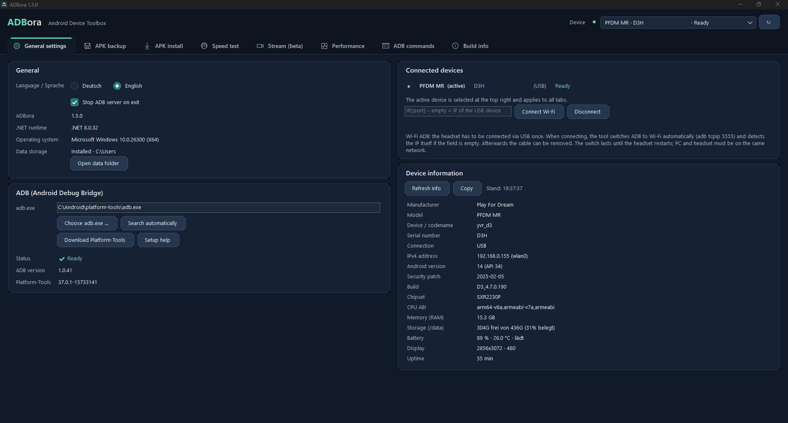

# ADBora – Android Device Toolbox

**[Deutsch](#deutsch) · [English](#english)**

---



## Deutsch

**ADBora** ist eine native Windows-Anwendung (.NET 8 WinForms, dunkles Theme), die das
**APK Backup Tool** und den **ADB USB Speed Test** in einem Programm vereint –
ergänzt um APK-Installation, WLAN-ADB und eine ADB-Konsole mit gespeicherten Befehlen.
Oberfläche umschaltbar zwischen Deutsch und Englisch. Kein Python und keine
separate .NET-Laufzeit nötig (self-contained).

### Download-Varianten

| Variante | Datei | Einstellungen & Cache |
|---|---|---|
| **Portabel** | `ADBora-Portable-<Version>-Windows-x64.zip` entpacken, `ADBora.exe` starten | Ordner `Data` neben der EXE (erkennbar an `portable.flag`) – nichts wird ausserhalb des Ordners gespeichert |
| **Installer** | `ADBora-Setup-<Version>.exe` | `%LOCALAPPDATA%\ADBora`; Startmenü-Eintrag, optional Desktop-Symbol, sauberer Deinstaller unter „Apps“ |

Der Installer kann ohne Administratorrechte (nur für den aktuellen Benutzer)
oder für alle Benutzer installieren. Beim **Deinstallieren** wird gefragt, ob
die Nutzerdaten (Einstellungen, gespeicherte Befehle, Metadaten-Cache) ebenfalls
gelöscht werden sollen. APK-Backups werden nie gelöscht.
Die aktuelle Datenablage steht im Tab „Allgemeine Einstellungen“ → „Datenablage“.

### Tabs

| Tab | Inhalt |
|---|---|
| **1 · Allgemeine Einstellungen** | Sprache, ADB einrichten (adb.exe wählen, automatisch suchen, Platform-Tools-Download, Einrichtungshilfe), Versionen (ADBora, ADB, Platform-Tools, .NET, Windows), Datenablage, angeschlossene Geräte, WLAN-ADB, Geräteinformationen (Hersteller, Modell, IPv4-Adresse, Android-Version, Sicherheitspatch, Chipsatz, RAM, Speicher, Akku, Display, Laufzeit) |
| **2 · APK Backup** | Nachinstallierte Apps einlesen (Name, Version, Icon direkt aus der APK), APK / OBB / Android/data sichern – inkl. Split-APKs, SHA-256-Prüfsummen, `manifest.json`, `backup-report.json`, `INSTALL.txt`; einzelne Apps per Papierkorb-Symbol **deinstallieren** |
| **3 · APK Install** | APK per Drag & Drop installieren (Split-APKs werden erkannt), App-Ordner aus einem Backup inkl. OBB, **Batch-Restore** ganzer Backup-Ordner (APK, OBB und Daten, Auswahl pro App), OBB-Ordner nach `/sdcard/Android/obb/<Paket>` kopieren, Gerät (MTP) im Explorer öffnen |
| **4 · Speedtest** | ADB-Durchsatztest über USB oder WLAN: maximale stabile Transferrate (automatische Reduktion bei Abbrüchen) oder feste Bandbreite; Live-Werte und Verlauf |
| **5 · Stream (Beta)** | *Experimentell:* Headset-Bild live auf dem PC über scrcpy (USB oder WLAN), Display-, Ausschnitt-, Drehungs- und Neigungswahl mit Voreinstellungen für Quest 3 und Play For Dream, Ton/Mikrofon, MP4-Aufnahme, Screenshot |
| **6 · Performance** | Leistungswerte live per ADB (FPS, Frame-Zeiten, CPU-/GPU-Last, Takt, Temperaturen, Akku, RAM …) für Play For Dream und Meta Quest, Auswahl der Werte und Graphen, CSV-Protokoll, HUD-App im Headset ein-/ausschalten bzw. installieren |
| **7 · ADB Commands** | ADB-Befehle mit Live-Ausgabe, Stopp, Verlauf (↑/↓); **Befehle für das erkannte Gerät** (Meta Quest, Pico, Android), **Entdecken** (Apps, Systemwerte, Einstellungen, Dienste live vom Gerät) und eigene gespeicherte Befehle, optional pro Gerätemodell |
| **8 · Build Info** | Version, Build-Datum, Variante (installiert/portabel), .NET, ADB, Repo, Datenordner, Lizenz; **Update-Prüfung** und Auto-Update |

Das **aktive Gerät** wird oben rechts gewählt und gilt für alle Tabs (mehrere
Geräte werden unterstützt, ADB-Aufrufe laufen mit `-s <Seriennummer>`). Es läuft
immer nur ein ADB-Vorgang gleichzeitig. Wird ADBora während eines laufenden
Vorgangs (z. B. Backup) geschlossen, fragt es vorher nach.

### ADB / Android Platform Tools

ADB ist nicht enthalten. Gesucht wird in: gespeicherter Pfad, `adb\adb.exe` bzw.
`platform-tools\adb.exe` neben der EXE, `PATH`, `ANDROID_SDK_ROOT` / `ANDROID_HOME`,
`%LOCALAPPDATA%\Android\Sdk\platform-tools`, `C:\Android\platform-tools`.
Fehlt ADB, öffnet sich die Einrichtungshilfe.
Download: https://developer.android.com/tools/releases/platform-tools

### APK Backup

| Komponente | Quelle auf Android | Ziel im App-Ordner |
|---|---|---|
| APK | alle von `pm path` gemeldeten APKs | `APK/App-Name-Version.apk`; Split-Apps als eine `App-Name-Version.apks` (abschaltbar, dann Basis + Splits einzeln) |
| OBB | `/sdcard/Android/obb/<Paket>` | `OBB/` |
| Daten | `/sdcard/Android/data/<Paket>` | `Data/` |

Private Daten unter `/data/data` (Logins, interne Datenbanken, viele Spielstände)
sind **nicht** enthalten; es werden keine Root-Rechte verwendet. Verweigert ein
Gerät `adb pull`, wird `adb exec-out cat` verwendet. Einzelne Dateien, die ADB nicht lesen darf
(z. B. Shader-Caches mancher Spiele), werden übersprungen und in `manifest.json` aufgeführt. Jede APK wird erst nach
Grössen-, ZIP- und (falls verfügbar) SHA-256-Prüfung übernommen. App-Name,
Version und Icon werden im Metadaten-Cache gespeichert (nur Metadaten).

**Deinstallieren:** Papierkorb-Symbol am Zeilenende → Bestätigung →
`adb uninstall <Paket>`. App und App-Daten werden vom Gerät entfernt.

```text
Speicherort/
  Backup_2026-09-30_11-42-58_21264b/
    App-Name [com.example]/
      APK/  OBB/  Data/
      INSTALL.cmd
      INSTALL.txt
      manifest.json
    backup-report.json
```

### APK Install

- **APK:** eine oder mehrere `.apk` hineinziehen – oder App-Pakete `.apks` (SAI,
  AnExplorer, ADBora), `.xapk` (inkl. OBB) und unverschlüsselte `.apkm`. Mehrere APKs desselben Pakets
  werden als Split-App installiert (`adb install-multiple -r`), sonst einzeln
  (`adb install -r`). Optional `-d` (Downgrade) und `-g` (Berechtigungen).
- **Backup-Ordner:** App-Ordner `Name [Paket]` hineinziehen – installiert `APK/`
  und kopiert `OBB/`.
- **Batch-Restore:** „Batch-Restore …“ oder einen ganzen Backup-Ordner (`Backup_…`
  oder den Ordner mit mehreren Backups) auf das APK-Feld ziehen. In der Liste pro
  App wählen, was wiederhergestellt wird: **APK** installieren → **OBB** nach
  `/sdcard/Android/obb/<Paket>` → **Daten** nach `/sdcard/Android/data/<Paket>`
  (die App wird vorher beendet; die Daten laufen über `/data/local/tmp`, weil
  neuere Android-Versionen `adb push` direkt nach `Android/data` ablehnen).
- **OBB:** Ordner hineinziehen; Paketname aus Ordnername, Backup-Ordner,
  `manifest.json` oder `main.<Version>.<Paket>.obb`, sonst Nachfrage.
- **Explorer:** öffnet das Gerät unter „Dieser PC“ (MTP), sonst „Dieser PC“.

### Updates

ADBora prüft beim Start (abschaltbar im Tab „Build Info“) die neueste Version auf
GitHub. Bei einem Update erscheinen die Versionshinweise; **„Jetzt aktualisieren“**
lädt das passende Paket (SHA-256-geprüft): die installierte Version wird still per
Setup aktualisiert, die portable Version direkt im Programmordner (der Ordner
`Data` bleibt erhalten). ADBora startet danach automatisch neu. Einzelne Versionen
lassen sich überspringen.

### WLAN-ADB

1. Headset einmal per USB anschliessen (Status „Bereit“).
2. Feld leer lassen (oder `IP[:Port]` eingeben) und **WLAN verbinden** klicken.
3. Klappt die direkte Verbindung nicht, schaltet das Tool ADB auf dem USB-Gerät
   auf WLAN um (`adb tcpip 5555`), ermittelt die IP und verbindet. Danach kann
   das Kabel ab; das WLAN-Gerät wird aktives Gerät.

Gilt bis zum nächsten Neustart des Headsets. PC und Headset müssen im selben
Netz sein (kein Gäste-WLAN / keine Client-Isolation).

### Speedtest – Messprinzip

```text
PC-TCP-Sender → adb reverse → USB/WLAN → toybox nc (Gerät) → /dev/null
```

Es wird nichts auf dem Gerät gespeichert. Der Wert ist der Durchsatz dieses
ADB/TCP-Pfads, nicht die theoretische Busgeschwindigkeit.

### Stream (Beta, experimentell)

- Nutzt **scrcpy** (Open Source, Apache-2.0); wird beim ersten Mal per Knopfdruck von GitHub
  geladen (`%LOCALAPPDATA%\ADBora\tools` bzw. `Data\tools`), keine App auf dem Headset nötig.
- Das Bild ist das **rohe Headset-Display**: bei der Quest beide Augen nebeneinander und
  schief eingebaut, bei der Play For Dream ein 2 × 2-Raster auf einem eigenen Display.
  ADBora wählt passendes Display, Ausschnitt und Drehung automatisch; mit **Grösse,
  Versatz und Neigung** lässt sich nachjustieren (wird pro Gerätemodell gemerkt).
  Ein entzerrtes Breitbild wie beim offiziellen Casting ist so nicht möglich.
- Ton des Headsets oder Mikrofon, Steuerung per Maus/Tastatur (optional), Aufnahme als MP4
  (`Videos\ADBora`), Screenshot (`Bilder\Screenshots`).
- Während des Streams: Näherungssensor aus (Quest) bzw. Display-Timeout 1 Stunde (andere
  Geräte); der alte Wert wird danach wiederhergestellt.

### Performance

- Liest die Werte der **XR-Runtime** aus dem Logcat (Play For Dream: `PerfStats` /
  `CompositorMonitor`, Meta Quest: `VrApi`) und **Systemwerte** über eine kleine Shell-Schleife
  (CPU-/GPU-Last und -Takt, Temperaturen, Akku, freier RAM, Thermik-Status) – ohne Root und
  ohne App auf dem Headset. XR-Werte erscheinen, sobald eine VR-App läuft.
- **Werte auswählen …**: pro Wert Kachel und/oder Graph (bis 6 Verläufe über 2 Minuten mit
  Min/Ø/Max); die Spalte „Aktuell“ zeigt, was das Gerät liefert – nicht jedes Headset liefert
  jeden Wert (die Quest z. B. keine Temperaturen). Auswahl wird gemerkt.
- **CSV-Protokoll** nach `Dokumente\ADBora\Metrics` (eine Zeile pro Sekunde).
- **HUD im Headset**: [PFD-Metrics](https://github.com/urscaviezel/PFD-Metrics) (Play For Dream)
  bzw. OVR Metrics Tool (Quest) ein-/ausschalten. Fehlt die App, installiert ADBora PFD-Metrics
  direkt aus dem GitHub-Release; für die Quest öffnet sich die Meta-Store-Seite des OVR Metrics Tool.
- **Akku-Strom / Leistungsaufnahme (W)** beim Play For Dream kommen von PFD-Metrics (dort muss
  die Messung laufen). Spannung, Strom und Leistung sind nur im **Standalone-Betrieb**
  (WLAN-ADB) korrekt – über USB verfälscht das Laden die Werte. Die Quest liefert sie nicht.

### ADB Commands

- Präfix `adb` ist optional. Bei `shell …` geht der Rest der Zeile unverändert an
  die Geräte-Shell (Pipes/Anführungszeichen, z. B. `shell dumpsys battery | grep level`).
- „An aktives Gerät senden (-s)“ ergänzt `-s <Seriennummer>` (nicht bei `devices`, `version`, `connect` …).
- Dauerläufer wie `logcat` mit **Stopp** beenden.
- Eigene Befehle: eingeben → **Aktuellen Befehl speichern …** → Name vergeben; optional
  „Nur für dieses Gerätemodell anzeigen“.
- **Befehle für dieses Gerät:** ADBora erkennt Hersteller und Modell des aktiven Geräts und
  bietet passende Befehle mit Beschreibung an – allgemeine Android-Befehle (Geräteinfo, Apps,
  Eingabe, Diagnose, System) und bei einer Meta Quest zusätzlich z. B. Bildwiederholrate,
  Texturgrösse, CPU-/GPU-Level, Näherungssensor, Guardian. Riskante Befehle sind markiert
  (! / ⚠) und werden vor dem Ausführen bestätigt; Platzhalter wie `<paket>` müssen ersetzt werden.
- **Entdecken …:** liest Apps, Systemwerte (getprop), Einstellungen (settings) und
  Systemdienste (cmd) live vom Gerät, durchsuchbar; daraus entstehen per Klick Befehle
  (App starten/beenden, Wert lesen/setzen, Dienst-Hilfe …).

### Build

Voraussetzung (nur Build-PC): .NET 8 SDK, für den Installer zusätzlich
[Inno Setup 6](https://jrsoftware.org/isdl.php).

```text
build\BUILD.cmd
```

Ergebnis in `dist\`: `ADBora-Portable\`, `ADBora-Portable-<Version>-Windows-x64.zip`
und – falls Inno Setup installiert ist – `ADBora-Setup-<Version>.exe`.
Optional Platform-Tools nach `build\adb\` kopieren, dann werden sie mitgeliefert.
Diagnose: `ADBora.exe --check-apk <datei.apk>`.

### Lizenz

GPL-3.0 (siehe `LICENSE`). Android Debug Bridge / Platform Tools sind separate
Google-Komponenten und nicht Teil dieses Projekts. Erstellt von
[@urscaviezel](https://github.com/urscaviezel).

---

## English

**ADBora** is a native Windows application (.NET 8 WinForms, dark theme) that combines the
**APK Backup Tool** and the **ADB USB Speed Test** in one program – extended with
APK installation, Wi-Fi ADB and an ADB console with saved commands. The UI can
be switched between German and English. No Python and no separate .NET runtime
required (self-contained).

### Download variants

| Variant | File | Settings & cache |
|---|---|---|
| **Portable** | extract `ADBora-Portable-<version>-Windows-x64.zip`, run `ADBora.exe` | `Data` folder next to the EXE (marked by `portable.flag`) – nothing is stored outside the folder |
| **Installer** | `ADBora-Setup-<version>.exe` | `%LOCALAPPDATA%\ADBora`; Start menu entry, optional desktop icon, clean uninstaller in "Apps" |

The installer can install without administrator rights (current user only) or
for all users. When **uninstalling**, you are asked whether the user data
(settings, saved commands, metadata cache) should be deleted as well. APK
backups are never deleted. The current data location is shown in
"General settings" → "Data storage".

### Tabs

| Tab | Content |
|---|---|
| **1 · General settings** | Language, ADB setup (choose adb.exe, auto search, Platform-Tools download, setup help), versions (ADBora, ADB, Platform-Tools, .NET, Windows), data storage, connected devices, Wi-Fi ADB, device information (manufacturer, model, IPv4 address, Android version, security patch, chipset, RAM, storage, battery, display, uptime) |
| **2 · APK backup** | Scan user-installed apps (name, version, icon read from the APK), back up APK / OBB / Android/data – incl. split APKs, SHA-256 checksums, `manifest.json`, `backup-report.json`, `INSTALL.txt`; **uninstall** single apps via the trash icon |
| **3 · APK install** | Install APKs via drag & drop (split APKs detected), app folders from a backup incl. OBB, **batch restore** of whole backup folders (APK, OBB and data, selectable per app), copy OBB folders to `/sdcard/Android/obb/<package>`, open the device (MTP) in Explorer |
| **4 · Speed test** | ADB throughput test via USB or Wi-Fi: maximum stable transfer rate (automatic reduction on disconnects) or fixed bandwidth; live values and history |
| **5 · Stream (beta)** | *Experimental:* headset view live on the PC via scrcpy (USB or Wi-Fi), display, view, rotation and tilt settings with presets for Quest 3 and Play For Dream, audio/microphone, MP4 recording, screenshot |
| **6 · Performance** | Live performance values via ADB (FPS, frame times, CPU/GPU load, clocks, temperatures, battery, RAM …) for Play For Dream and Meta Quest, choice of values and graphs, CSV log, switch or install the HUD app on the headset |
| **7 · ADB commands** | ADB commands with live output, stop, history (↑/↓); **commands for the detected device** (Meta Quest, Pico, Android), **Explore** (apps, system properties, settings, services live from the device) and your own saved commands, optionally per device model |
| **8 · Build info** | Version, build date, variant (installed/portable), .NET, ADB, repo, data folder, license; **update check** and auto-update |

The **active device** is selected at the top right and applies to all tabs
(several devices supported, ADB calls use `-s <serial>`). Only one ADB operation
runs at a time. If ADBora is closed while an operation (e.g. a backup) is running,
it asks first.

### ADB / Android Platform Tools

ADB is not included. Search order: saved path, `adb\adb.exe` or
`platform-tools\adb.exe` next to the EXE, `PATH`, `ANDROID_SDK_ROOT` / `ANDROID_HOME`,
`%LOCALAPPDATA%\Android\Sdk\platform-tools`, `C:\Android\platform-tools`.
If ADB is missing, the setup help opens.
Download: https://developer.android.com/tools/releases/platform-tools

### APK backup

| Component | Source on Android | Target in the app folder |
|---|---|---|
| APK | all APKs reported by `pm path` | `APK/App-Name-Version.apk`; split apps as one `App-Name-Version.apks` (can be switched off, then base + splits as single files) |
| OBB | `/sdcard/Android/obb/<package>` | `OBB/` |
| Data | `/sdcard/Android/data/<package>` | `Data/` |

Private data in `/data/data` (logins, internal databases, many save games) is
**not** included; no root access is used. If a device refuses `adb pull`,
`adb exec-out cat` is used. Single files ADB may not read (e.g. shader caches of
some games) are skipped and listed in `manifest.json`. Every APK is only kept after size, ZIP and (if
available) SHA-256 verification. App name, version and icon are stored in the
metadata cache (metadata only).

**Uninstall:** trash icon at the end of the row → confirmation →
`adb uninstall <package>`. The app and its data are removed from the device.

### APK install

- **APK:** drop one or more `.apk` files – or app bundles `.apks` (SAI, AnExplorer,
  ADBora), `.xapk` (incl. OBB) and unencrypted `.apkm`. Several APKs of the same package are
  installed together as a split app (`adb install-multiple -r`), otherwise one
  by one (`adb install -r`). Optional `-d` (downgrade) and `-g` (permissions).
- **Backup folder:** drop an app folder `Name [package]` – installs `APK/` and copies `OBB/`.
- **Batch restore:** click "Batch restore …" or drop a whole backup folder (`Backup_…`
  or the folder containing several backups) onto the APK field. Choose per app what
  to restore: install **APK** → **OBB** to `/sdcard/Android/obb/<package>` → **data**
  to `/sdcard/Android/data/<package>` (the app is stopped first; data goes through
  `/data/local/tmp` because newer Android versions refuse `adb push` into `Android/data`).
- **OBB:** drop a folder; package name from the folder name, backup folder,
  `manifest.json` or `main.<version>.<package>.obb`, otherwise you are asked.
- **Explorer:** opens the device under "This PC" (MTP), otherwise "This PC".

### Updates

At start (can be switched off in the "Build info" tab) ADBora checks GitHub for the
latest version. If there is an update, the release notes are shown; **"Update now"**
downloads the matching package (SHA-256 verified): the installed version is updated
silently by its setup, the portable version directly in its program folder (the
`Data` folder is kept). ADBora restarts automatically. Single versions can be skipped.

### Wi-Fi ADB

1. Connect the headset via USB once (status "Ready").
2. Leave the field empty (or enter `IP[:port]`) and click **Connect Wi-Fi**.
3. If a direct connection fails, the tool switches ADB on the USB device to
   Wi-Fi (`adb tcpip 5555`), detects the IP and connects. Afterwards the cable
   can be removed; the Wi-Fi device becomes the active device.

Valid until the headset restarts. PC and headset must be on the same network
(no guest Wi-Fi / client isolation).

### Speed test – how it works

```text
PC TCP sender → adb reverse → USB/Wi-Fi → toybox nc (device) → /dev/null
```

Nothing is written to the device. The value is the throughput of this ADB/TCP
path, not the theoretical bus speed.

### Stream (beta, experimental)

- Uses **scrcpy** (open source, Apache-2.0); downloaded from GitHub with one click the first
  time (`%LOCALAPPDATA%\ADBora\tools` or `Data\tools`), no app needed on the headset.
- The picture is the **raw headset display**: on the Quest both eyes side by side and mounted
  tilted, on the Play For Dream a 2 × 2 grid on a separate display. ADBora picks display,
  view and rotation automatically; **size, offset and tilt** fine-tune it (remembered per
  device model). An undistorted wide picture like official casting is not possible this way.
- Headset audio or microphone, optional mouse/keyboard control, MP4 recording
  (`Videos\ADBora`), screenshot (`Pictures\Screenshots`).
- While streaming: proximity sensor off (Quest) or display timeout 1 hour (other devices);
  the previous value is restored afterwards.

### Performance

- Reads the **XR runtime** values from logcat (Play For Dream: `PerfStats` /
  `CompositorMonitor`, Meta Quest: `VrApi`) and **system values** via a small shell loop
  (CPU/GPU load and clock, temperatures, battery, free RAM, thermal status) – no root and no
  app on the headset. XR values appear as soon as a VR app is running.
- **Select values …**: tile and/or graph per value (up to 6 histories over 2 minutes with
  min/avg/max); the "Current" column shows what the device delivers – not every headset
  delivers every value (the Quest e.g. no temperatures). The selection is remembered.
- **CSV log** to `Documents\ADBora\Metrics` (one row per second).
- **HUD on the headset**: switch [PFD-Metrics](https://github.com/urscaviezel/PFD-Metrics)
  (Play For Dream) or OVR Metrics Tool (Quest) on/off. If the app is missing, ADBora installs
  PFD-Metrics straight from the GitHub release; for the Quest the Meta Store page of the OVR
  Metrics Tool opens.
- **Battery current / power draw (W)** on the Play For Dream come from PFD-Metrics (its
  monitoring must be running). Voltage, current and power are only correct in **standalone
  use** (Wi-Fi ADB) – over USB, charging distorts them. The Quest does not deliver them.

### ADB commands

- The `adb` prefix is optional. With `shell …` the rest of the line is passed
  unchanged to the device shell (pipes/quotes, e.g. `shell dumpsys battery | grep level`).
- "Send to active device (-s)" adds `-s <serial>` (not for `devices`, `version`, `connect` …).
- Stop long-running commands such as `logcat` with **Stop**.
- Own commands: type → **Save current command …** → enter a name; optionally
  "Show only for this device model".
- **Commands for this device:** ADBora detects manufacturer and model of the active device
  and offers matching commands with descriptions – general Android commands (device info,
  apps, input, diagnostics, system) and on a Meta Quest additionally e.g. refresh rate,
  texture size, CPU/GPU level, proximity sensor, Guardian. Risky commands are marked (! / ⚠)
  and confirmed before running; placeholders like `<paket>` must be replaced.
- **Explore …:** reads apps, system properties (getprop), settings and system services (cmd)
  live from the device, searchable; one click builds commands from them (start/stop app,
  read/set value, service help …).

### Build

Requirements (build PC only): .NET 8 SDK, for the installer additionally
[Inno Setup 6](https://jrsoftware.org/isdl.php).

```text
build\BUILD.cmd
```

Output in `dist\`: `ADBora-Portable\`, `ADBora-Portable-<version>-Windows-x64.zip`
and – if Inno Setup is installed – `ADBora-Setup-<version>.exe`.
Optionally copy Platform Tools to `build\adb\` to bundle them.
Diagnostics: `ADBora.exe --check-apk <file.apk>`.

### License

GPL-3.0 (see `LICENSE`). Android Debug Bridge / Platform Tools are separate
Google components and not part of this project. Created by
[@urscaviezel](https://github.com/urscaviezel).
